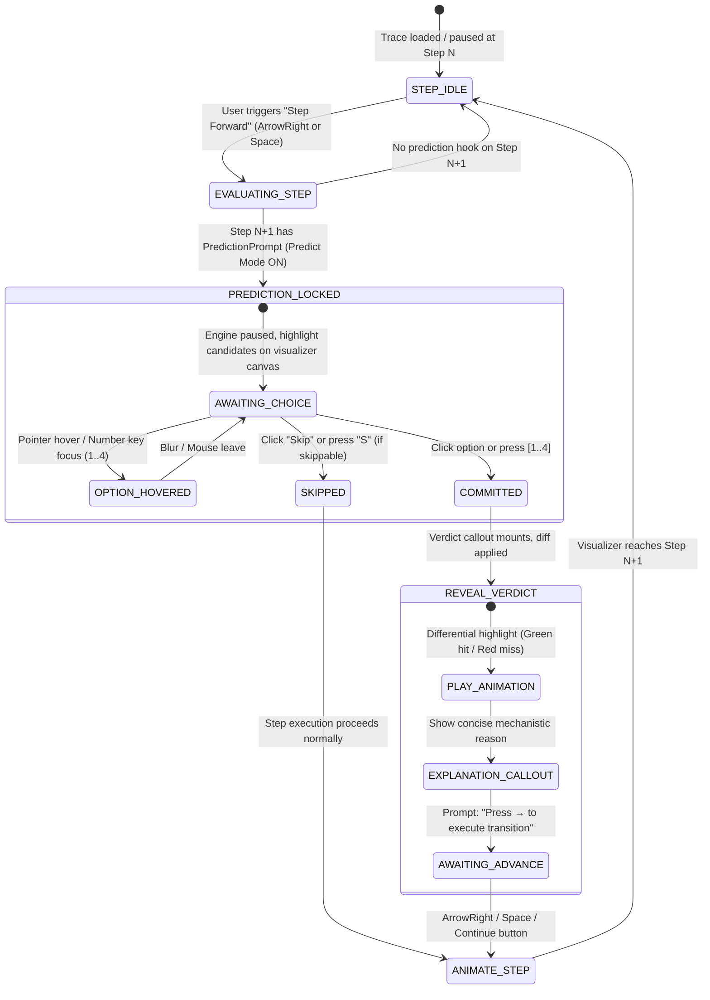
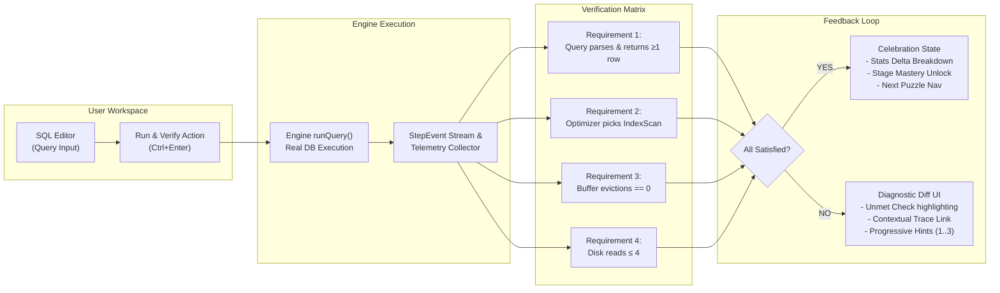
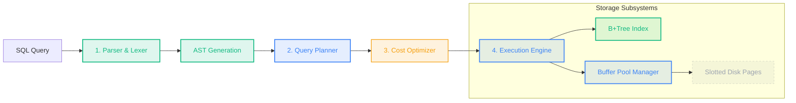

# Design Research: Interactive Learning & Step-Debugger UX

> **Task Contract**: R3 — Design Research: Interactive Learning & Step-Debugger UX  
> **Target Subsystems**: QueryLens Playground (`/playground`), Challenges (`/challenges`), Learn (`/learn`), and Progress (`/progress`)  
> **Downstream Consumers**: Task T4 (Playground Layout & Playback Controls), Task T8 (Learn Curriculum, Challenges & Progress Dashboard)  
> **Status**: Completed Research & Specification Document

---

## Executive Summary

QueryLens is an educational, 100% client-side database internals visualizer designed to demystify relational database engine mechanics (parsing, planning, optimization, buffer pool management, B+Tree indexing, locking, and execution). However, decades of computer science education research—most notably the meta-analyses of Hundhausen, Douglas, and Stasko (2002), and the empirical findings of Hansen, Schrimpsher, and Narayanan on HalVis (2000)—demonstrate that **passive visualization produces virtually no statistically significant learning gain over well-written static text**. When learners passively watch an animated execution, they suffer from an *illusion of competence*: visual motion feels intuitive and satisfying, but mental models remain shallow and fragile.

The single intervention proven to produce statistically significant comprehension gains is **active knowledge construction through cognitive commitment**: forcing the learner to formulate a hypothesis and commit to a prediction *immediately before* the system executes and reveals the state change.

This document establishes the interaction design, interface architecture, state machines, and UX patterns for three core pedagogical pillars in QueryLens:
1. **Predict-Then-Reveal Step-Debugger UX**: A frictionless, non-intrusive cognitive checkpointing interface that gates critical engine transitions (buffer evictions, index branch traversals, filter pushdowns, join algorithm executions), animates the reveal, and provides diagnostic remediation.
2. **Challenge Mode UI (`/challenges`)**: A goal-driven puzzle interface featuring declarative multi-criteria requirement checklists, instant run-and-verify evaluation against raw engine telemetry, and restrained, developer-grade celebration micro-states.
3. **Mastery Progress Dashboard (`/progress`)**: A privacy-preserving, zero-cloud progress dashboard tracking pipeline stage mastery roadmaps, prediction accuracy and calibration metrics, and challenge completion matrices.

---

## 1. Pedagogical Foundation & Reference Benchmark

### 1.1 The Science of Cognitive Commitment
In traditional step-debuggers, learners click "Step Next" repeatedly, observing state mutations passively. In contrast, the **predict-then-reveal** paradigm introduces a deliberate micro-pause at pivotal branch points. 

```
┌─────────────────┐       ┌────────────────────┐       ┌─────────────────────┐
│  State N Ready  │ ────> │ Commitment Barrier │ ────> │ State N+1 Revealed  │
│ (Context Visible│       │ (Forced Prediction)│       │ (Visual Delta +     │
│  Evidence Shown)│       │                    │       │  Explanation)       │
└─────────────────┘       └────────────────────┘       └─────────────────────┘
                                    │
                                    ▼
                     A wrong guess committed to
                     creates a "prediction error"
                     dopamine delta that primes the
                     brain for conceptual rewiring.
```

The pedagogical value stems from three cognitive mechanisms:
* **Prediction Error Generation**: Neuroscience shows that memory consolidation and conceptual rewiring occur most intensely when expectations diverge from ground truth. A learner who predicts page eviction based on FIFO, but witnesses LRU evict a different page, experiences a salient cognitive dissonance that directly destabilizes their faulty mental model.
* **Elimination of Hindsight Bias**: When answers are revealed without prior commitment, learners invariably rationalise: *"Oh, of course page 4 was evicted, that makes sense."* Committing locks the hypothesis in place.
* **Low Stakes, High Frequency**: Micro-predictions take 3–5 seconds to answer. They must not feel like evaluative formal exams, but rather like conversational checkpoints with a pair programmer.

### 1.2 Reference Systems Benchmark

| System | Key Mechanic | UX Strengths | UX Deficiencies / Anti-Patterns to Avoid |
| :--- | :--- | :--- | :--- |
| **VisuAlgo** | e-Lecture quizzing with step prediction during tree traversals and sorting. | Direct coupling between question and graphical canvas; steps pause at algorithm branch points. | Intrusive modal dialogues that obscure the underlying data structures; jarring alert boxes; lack of keyboard ergonomics; desktop-centric touch targets. |
| **Brilliant.org** | Interactive concept cards with tactile sliders, node dragging, and instant hypothesis verification. | Impeccable micro-copy; playful tactile feedback; progressive disclosure of hints; visual causality (sliding a parameter highlights the affected curve). | Overly scripted rail-shooter interactions; hides real code/AST underlying the system; impossible to run arbitrary user queries. |
| **Codecademy** | Three-column workspace (Lesson/Instructions, Code Editor, Terminal/Output) with step-by-step checklist. | Clear checklist items with dynamic checkmark indicators; persistent instructions alongside workspace; clear "Run" feedback loop. | Slow feedback loop; opaque test failure messages ("Did you format line 4 correctly?"); disconnected from runtime internal memory representations. |
| **Bret Victor / Explorable Explanations** | Scrubbable numbers, continuous reactive state, visual representations of time and memory. | Instantaneous feedback without modal gates; rich visual feedback showing cause-and-effect concurrently. | Can overwhelm novice learners with unconstrained dials; lacks structured pedagogical scaffolding for database algorithms that operate in discrete procedural stages. |

### 1.3 The QueryLens Philosophy
QueryLens merges the epistemic fidelity of real database engine execution with the interactive cognitive engagement of Brilliant and HalVis:
* **The Engine Never Lies**: Every prediction and challenge runs against the 100% faithful client-side engine (`BufferPool`, `BTree`, `Planner`, `Executor`). No mocked question states or pre-canned dummy animations.
* **Developer-Grade Restraint**: No cartoony mascots, loud gamification badges, or disruptive modal takeovers. The interface feels like an ultra-refined observability tool (Chrome DevTools meets Datadog).
* **Frictionless Keyboard Ergonomics**: Power users can navigate, predict, step, and verify without lifting their fingers from the keyboard.

---

## 2. Predict-Then-Reveal: Interaction Flow & Architecture

### 2.1 The Prediction Lifecycle
A prediction is not an arbitrary pop quiz; it is an event-driven barrier triggered when the engine reaches a state where an internal algorithmic rule chooses between two or more discrete candidates.



### 2.2 Natural Engine Prediction Hooks in QueryLens
Predictions map directly to `StepEvent` discriminated unions in `src/engine/types.ts`:

1. **Buffer Pool Eviction (`buffer:evict`)**:
   * *Trigger*: Buffer pool frame capacity is reached, and a page miss occurs.
   * *Question*: *"Buffer pool is full (8/8 frames). Which frame will be evicted under the active LRU/Clock policy?"*
   * *Candidates*: Frames 0 through 7 (with current pin counts, dirty bits, and reference/age metadata visibly displayed on the frames).
   * *Reveal*: Evicted frame pulses red with an extraction motion; replacement page slides in with green border.

2. **B+Tree Index Traversal (`index:traverse` / `index:seek`)**:
   * *Trigger*: Traversing from an internal node to child pointers during index lookup for key $K$.
   * *Question*: *"Searching for key `id = 42`. Which child pointer will the index follow next?"*
   * *Candidates*: Left child pointer ($< 25$), Middle pointer ($25 \le K < 50$), Right pointer ($\ge 50$).
   * *Reveal*: The traversed branch illuminates with a directed pulse; irrelevant branches dim to 30% opacity.

3. **Query Optimizer Transformation (`optimize:rule`)**:
   * *Trigger*: Logical plan tree evaluation.
   * *Question*: *"The query contains `WHERE age > 30`. At which stage of the plan tree will this filter predicate be evaluated?"*
   * *Candidates*: A: Immediately at table scan (Predicate Pushdown); B: After scanning all records into memory; C: At the root projection node.
   * *Reveal*: Visual plan tree animates the filter node sliding down below the join or scan operator.

4. **Join Strategy Selection (`planner:join-algorithm`)**:
   * *Trigger*: Multi-table query planning with size statistics.
   * *Question*: *"Inner table has 10 rows; outer table has 1,000 rows. Which join algorithm minimizes disk operations?"*
   * *Candidates*: Hash Join, Index Nested Loop Join, Block Nested Loop Join.
   * *Reveal*: Cost estimate breakdown reveals CPU vs I/O cost trade-offs.

5. **Dirty Page Writeback (`buffer:flush`)**:
   * *Trigger*: Evicting a frame whose `dirty === true`.
   * *Question*: *"Frame 3 has dirty bit = 1. What additional disk operation occurs before page 10 can be loaded?"*
   * *Candidates*: A: Direct overwrite; B: Writeback flush to disk page file; C: Discard without write.
   * *Reveal*: Write arrow shoots from buffer frame to disk slot before read arrow fetches new page.

---

### 2.3 Detailed Interaction Flow: Gating, Reveal, Callout, & Remediation

#### Stage 1: The Commitment Gate
* **Visual Anchor**: When paused at a prediction gate, the active visualizer (Buffer Pool grid, B+Tree canvas, or AST/Plan tree) does *not* freeze behind an opaque overlay. Instead:
  * The relevant candidate elements on canvas pulse with an accent ring (`ring-2 ring-accent/60 animate-pulse`).
  * The **Prediction Card** appears docked at the bottom-right on desktop (or slides up as a bottom sheet on mobile).
* **Affordance**: Each choice is presented with:
  * Numbered hotkey badge (`[1]`, `[2]`, `[3]`, `[4]`).
  * Direct click target on the card.
  * Direct click target on the corresponding canvas element (e.g., clicking Frame #3 on the Buffer Pool grid selects option "Frame 3").
* **Commitment Action**: A single click or keystroke records the answer. Once clicked, options lock immediately to prevent backtracking.

#### Stage 2: Reveal Animation & Visual Consequence
* **Animation Discipline**:
  * Correct Guess: The selected option border flashes **Emerald (OKLCH `oklch(0.72 0.19 152)`)**, accompanied by a subtle 150ms spring scale (`scale-[1.02]`). On the canvas, the predicted component illuminates.
  * Incorrect Guess: The selected option turns **Rose (OKLCH `oklch(0.63 0.22 25)`)**; simultaneously, the *actual* victim/path element flashes Amber/Emerald, visually drawing the learner's eyes from their incorrect choice to the true target.
* **Duration**: Reveal animation runs for 350ms, followed immediately by the inline explanation callout.

#### Stage 3: Explanatory Callouts ("Why This Happened")
The explanation callout must never simply state *"Correct"* or *"Wrong"*. It must follow a structured **Mechanics-First Anatomy**:

```
┌────────────────────────────────────────────────────────────────────────┐
│  [✗] Not quite. You predicted Frame 2 (Page 4).                        │
│                                                                        │
│  Why Frame 5 was evicted instead:                                      │
│  Under the active LRU policy, Frame 2 was accessed at Step 8, giving    │
│  it an age of 2 steps. Frame 5 was last read at Step 1 (age = 9 steps)  │
│  and has pin count = 0, making it the oldest unpinned frame in the pool. │
│                                                                        │
│  [ Try Similar Step ]   [ Replay Access Sequence ]   [ Press → Continue ] │
└────────────────────────────────────────────────────────────────────────┘
```

* **Ground-Truth Callout Structure**:
  1. **Verdict Header**: Direct outcome summary.
  2. **Rule Citation**: Name of the active engine policy or algorithm.
  3. **State Proof**: Concrete metrics from current state (e.g., `pinCount = 0`, `lastAccess = t-9`, `key < node.keys[0]`).
  4. **Action Prompt**: Explicit guide on how to advance or inspect further.

#### Stage 4: Counterfactual Inspection & Error Remediation
When a learner gets a prediction wrong, cognitive tension is at its peak. QueryLens provides two instant remediation levers:
1. **"Inspect Past Accesses" (Temporal Scrubbing)**:
   Hovering over the explanation temporarily highlights historical accesses in the buffer worksheet or execution timeline without resetting the current step.
2. **"What-If" Counterfactual Forking**:
   A lightweight action button: *"What would Clock policy do here?"* Clicking it displays a 1-sentence simulation comparing how an alternative policy would have resolved the same frame state.

---

### 2.4 Mobile vs. Desktop Ergonomics for Predict-Then-Reveal

```
┌────────────────────────────────────────────────────────────────────────────────────────────┐
│ DESKTOP (Viewport ≥ 1024px)                                                                 │
│                                                                                            │
│ ┌───────────────────────────────────────────────┐ ┌──────────────────────────────────────┐ │
│ │ Visualizer Stage (Buffer Pool / B+Tree)       │ │ Docked Side Inspector                │ │
│ │                                               │ │                                      │ │
│ │  [Frame 0]  [Frame 1]  [Frame 2 (Hovered)]   │ │ ┌──────────────────────────────────┐ │ │
│ │  [Frame 3]  [Frame 4]  [Frame 5]             │ │ │ Prediction Card (Docked HUD)     │ │ │
│ │                                               │ │ │ [?] Predict Next Eviction        │ │ │
│ │  (Interactive SVG / HTML Grid Canvas)         │ │ │                                  │ │ │
│ │                                               │ │ │ [1] Frame 0 (Page 1)             │ │ │
│ │                                               │ │ │ [2] Frame 2 (Page 4)             │ │ │
│ │                                               │ │ │ [3] Frame 5 (Page 2)             │ │ │
│ │                                               │ │ ├──────────────────────────────────┤ │ │
│ │                                               │ │ │ Keyboard: 1-3 to pick · S to skip│ │ │
│ └───────────────────────────────────────────────┘ └──────────────────────────────────────┘ │
│ ┌────────────────────────────────────────────────────────────────────────────────────────┐ │
│ │ Playback Controls Dock: [⏮ First] [◀ Step] [▶ Play] [Step ▶] [⏭ Last]   Step 12/48   │ │
│ └────────────────────────────────────────────────────────────────────────────────────────┘ │
└────────────────────────────────────────────────────────────────────────────────────────────┘

┌─────────────────────────────────────────────────────┐
│ MOBILE (Viewport < 768px, Touch Portrait)           │
│                                                     │
│ ┌─────────────────────────────────────────────────┐ │
│ │ Compact Visualizer Canvas (Scrollable/Pinchable)│ │
│ │ [Frame 0] [Frame 1] [Frame 2]                   │ │
│ │ [Frame 3] [Frame 4] [Frame 5]                   │ │
│ └─────────────────────────────────────────────────┘ │
│                                                     │
│ ┌─────────────────────────────────────────────────┐ │
│ │ Bottom Sheet HUD (Slide-up drawer, 44px targets) │ │
│ │ ── Drag Handle ──                               │ │
│ │ PREDICT: Which frame gets evicted?              │ │
│ │                                                 │ │
│ │ [ Frame 0 (Page 1)                            ] │ │
│ │ [ Frame 2 (Page 4)                            ] │ │
│ │ [ Frame 5 (Page 2)                            ] │ │
│ │                                                 │ │
│ │ [ Skip Prediction ]          [ Step Forward → ] │ │
│ └─────────────────────────────────────────────────┘ │
└─────────────────────────────────────────────────────┘
```

#### Detailed Responsive Rules:
* **Desktop (1024px+)**:
  * Prediction Card is docked in the right inspector column or floats as a non-modal glass panel in the bottom-right corner.
  * Does **not** displace or shift the visualizer canvas (prevents layout jump).
  * Direct synchronization: Hovering over card option `[2] Frame 2` applies active CSS halo to Frame 2 on the main SVG canvas.
  * Hotkeys active: `1..9` select option; `S` skips; `Space` / `→` executes revealed step.
* **Mobile / Tablet (<768px)**:
  * Full modal takeovers block the visual evidence necessary to make an informed prediction. Therefore, mobile uses an **Anchored Bottom Sheet** with peek height of 140px, expandable to 60% viewport on drag.
  * Canvas automatically pans/scrolls so the focal candidate nodes remain visible above the bottom sheet.
  * Minimum touch target: `48px` height with `12px` touch margins.
  * Haptic vibration (`navigator.vibrate([15])`) on option selection for physical confirmation.

---

## 3. Challenge Mode UI: Goal-Oriented Puzzles & Verification

### 3.1 Anatomy of a Database Internals Challenge
Currently, `/challenges/:id` evaluates a single boolean check (`challenge.check(result, sql)`). While mathematically functional, this lacks pedagogical granularity: when a test fails, the user cannot tell *which* constraint broke.

A modernized challenge architecture decomposes puzzles into **Declarative Requirements Checklists**:



### 3.2 Requirements Checklist UI Pattern
Each challenge specification declares an array of atomic verification rules. The UI renders this checklist directly above or beside the code editor:

```
┌────────────────────────────────────────────────────────────────────────┐
│ CHALLENGE: "Index Hunter"                                              │
│ Goal: Fetch Alice's records without triggering a full table scan.      │
│                                                                        │
│ REQUIREMENTS CHECKLIST:                                                │
│  [✓] 1. Returns exact record for 'Alice' (Got: 1 row)                  │
│  [✓] 2. Execution plan uses IndexScan on users_idx (Got: IndexScan)    │
│  [✗] 3. Disk reads must not exceed 2 pages                             │
│         Current: 5 reads  ·  Target: ≤ 2 reads  (+3 excess reads)      │
│  [—] 4. Buffer pool dirty evictions remain at 0                        │
└────────────────────────────────────────────────────────────────────────┘
```

#### States per Checklist Item:
1. **Pending / Untested (`—`)**: Muted ink (`text-ink-dim/60`), outlined neutral ring.
2. **Passed (`✓`)**: Vivid emerald tone (`text-hit bg-hit/10 border-hit/40`), accompanied by actual metric tally (`"Got: 1 row"`).
3. **Failed (`✗`)**: Rose tone (`text-evict bg-evict/10 border-evict/40`), displaying a clear **Delta Comparison** (`"Current: 5 reads · Target: ≤ 2"`).

### 3.3 Instant Run-and-Verify Feedback Loop
* **Dual Execution Modes**:
  * **Debounced Passive Check (Syntax & Estimate)**: 300ms after keystroke, the parser and planner run invisibly. If syntax errors occur, a subtle underline appears in CodeMirror, but no intrusive errors block the user.
  * **Active "Run & Check" (Full Execution)**: Triggered via primary button or `Cmd+Enter` / `Ctrl+Enter`. Runs full storage engine and buffer pool, updating the telemetry badge cluster.
* **Telemetry Metric Badges**:
  Displays runtime ground truth in a monospace developer scoreboard:
  * `rows`: green if non-zero, red if empty.
  * `diskReads`: red if higher than target threshold, emerald if optimal.
  * `evictions`: amber if nonzero during an eviction-free challenge.
  * `indexUsed`: boolean badge with green pill for `IndexScan` / `IndexRangeScan`.
  * `dirtyFlushes`: tracking writeback penalties.

---

### 3.4 Progressive Hint Ladder
To prevent cognitive abandonment without handing the learner the answer immediately, challenges implement a 3-tier progressive hint ladder:

```
Level 1: Conceptual Hint (Always available)
         "Which column in the WHERE clause is indexed in the schema?"
               │
               ▼ (User requests more help after 2 failed runs)
Level 2: Structural Inspection Hint
         "Look at the Schema panel: `users` has an index on `(id)`,
          but your query filters on `(age)`. Sequential scan is forced."
               │
               ▼ (User requests final guidance)
Level 3: Query Scaffold / Shape Hint
         "Try rewriting the query to filter on `id = 5` or use an `id IN (...)` clause."
```

* **Anti-Spoiling Guard**: Hints are strictly opt-in (`aria-expanded` toggle) and track hint views in telemetry to measure puzzle difficulty.

---

### 3.5 Restrained Developer-Grade Celebration Micro-States
Mainstream consumer apps overwhelm users with confetti canons, full-screen popups, and sound effects. For developers and systems engineers, this creates friction and condescension. 

QueryLens implements a **Restrained, Tactile Celebration Micro-State**:

```
┌────────────────────────────────────────────────────────────────────────┐
│  ✓ CHALLENGE SOLVED                               [ Copy Solution ⎘ ]  │
│                                                                        │
│  Engine Efficiency Score: Optimal (2 disk reads, 0 evictions)           │
│  Unlocked: Buffer Pool Stage 3 Mastery Badge                            │
│                                                                        │
│  [ Next Challenge: Eviction Storm → ]     [ Inspect in Playground 🔍 ] │
└────────────────────────────────────────────────────────────────────────┘
```

* **Micro-Interactions**:
  1. **Border Sheen Sweep**: A single 400ms CSS linear-gradient shimmer sweeps across the challenge container border (`oklch(0.72 0.19 152)` emerald glow).
  2. **Checklist Cascade**: The unmet checklist items snap to green checkmarks with a 75ms staggered spring cascade.
  3. **Efficiency Rating**: Displays how the user's query performed relative to theoretical minimal I/O (e.g., *"Minimum possible disk reads achieved"*).
  4. **Deep-Link to Playground**: Immediate button to open the exact winning query and engine state inside the full Playground for multi-step timeline scrubbing.
  5. **Auto-Focus Progression**: Keyboard focus automatically shifts to the `"Next Challenge →"` button, allowing the user to press `Enter` and seamlessly continue.

---

## 4. Progress Tracking Dashboard & Mastery Roadmap

### 4.1 Data Architecture & Privacy Guarantees
All user progress in QueryLens is strictly client-side, zero-telemetry, and stored in `localStorage`. 

#### Storage Key Schema & Typing:
```typescript
/** Key: querylens:v2:progress */
export interface LearnerProgressV2 {
  version: 2;
  
  /** Pipeline stage discovery & interaction records */
  stages: {
    [stageId in Stage]: {
      seenInTrace: boolean;
      totalStepsExecuted: number;
      lastVisitedTimestamp: number;
      predictionCount: number;
      predictionCorrect: number;
    };
  };

  /** Prediction calibration log */
  predictions: {
    totalCommitted: number;
    totalCorrect: number;
    byCategory: {
      bufferEviction: { asked: number; right: number };
      indexTraversal: { asked: number; right: number };
      optimizerRules: { asked: number; right: number };
      joinAlgorithm:  { asked: number; right: number };
    };
    recentStreak: number;
    bestStreak: number;
  };

  /** Challenge completion ledger */
  challenges: {
    [challengeId: string]: {
      solved: boolean;
      solvedAt?: number;
      attemptsCount: number;
      hintsUsed: number;
      bestDiskReads?: number;
    };
  };

  /** Guided lesson completion */
  lessonsCompleted: string[]; // Lesson IDs
}
```

* **Resilience Discipline**: All read/write operations wrap in `try/catch`. If storage is blocked (Incognito mode, strict safari privacy, quota exceeded), the app degrades gracefully to session-in-memory storage without throwing or breaking UI rendering.

---

### 4.2 Mastery Metrics & Prediction Calibration Indicators

Rather than a simple vanity "80% correct" score, QueryLens visualizes **Prediction Calibration**:

```
┌────────────────────────────────────────────────────────────────────────┐
│ PREDICTION ACCURACY & CALIBRATION                                      │
│                                                                        │
│ Overall Accuracy: 78% (32 / 41 committed)       Current Streak: 4 🔥   │
│                                                                        │
│ Accuracy by Engine Subsystem:                                          │
│ Buffer Pool Eviction   ████████████████░░░░  82% (14/17)   [Proficient]│
│ B+Tree Index Path      ████████████████████  95% (10/11)   [Mastered]  │
│ Optimizer Pushdown     ████████░░░░░░░░░░░░  45% ( 4/9 )   [Needs Work]│
│ Join Algorithm Choice  ████████████░░░░░░░░  66% ( 4/6 )   [Practicing]│
│                                                                        │
│ Cognitive Insight:                                                     │
│ "You excel at physical index lookups, but often underestimate filter   │
│ pushdown rewrites. Try the 'Pushdown Pioneer' challenge."              │
└────────────────────────────────────────────────────────────────────────┘
```

#### Calibration Breakdown:
1. **Subsystem Competency Radar / Bars**: Breaks down hit rates by engine component so learners identify specific gaps in their mental model (e.g., strong on B+Tree, weak on optimizer heuristics).
2. **Confidence-Weighted Feedback**: Highlights that incorrect predictions on high-confidence questions represent the highest-value learning moments.
3. **Actionable Recommendations**: Directs the learner to specific challenges or lessons targeting their lowest-accuracy subsystem.

---

### 4.3 Database Internals Stage Mastery Roadmap
The `/progress` page presents the database pipeline as an interactive **Subsystem Transit Map**:



#### Mastery Stages & Criteria:
| Stage Tier | Visual Indicator | Criteria to Unlock |
| :--- | :--- | :--- |
| **Locked** (`○`) | Dashed border, 40% ink opacity | Subsystem has never been executed in a trace. |
| **Discovered** (`◔`) | Amber border, soft glow | Seen at least once in a Playground trace execution. |
| **Practiced** (`◑`) | Cyan border, medium weight | At least 3 predictions answered + 1 related challenge attempted. |
| **Mastered** (`●`) | Emerald solid border, sheen ring | All related challenges solved + $\ge 80\%$ prediction accuracy over 5+ trials. |

Clicking any node on the roadmap opens a **Subsystem Dossier Drawer** displaying:
* Concept summary and architecture diagrams.
* Direct link to launch a pre-configured Playground query highlighting that subsystem.
* Unlocked challenges associated with that stage.

---

## 5. Concrete Cross-Platform Design Specifications

### 5.1 Design Tokens & Theming Compatibility
All components adhere to the QueryLens semantic design tokens and OKLCH color space (compatible with Task T1 and dark/light modes):

* **Surface Tokens**:
  * Glass Card: `bg-surface-2/70 backdrop-blur-md border border-edge/60 shadow-e2`
  * Active/Gated Card: `bg-accent/[0.08] border-accent/60 shadow-e3`
  * Success/Hit Card: `bg-hit/10 border-hit/50 text-hit`
  * Error/Evict Card: `bg-evict/10 border-evict/50 text-evict`
* **Typography**:
  * Monospace Code & Numbers: `font-mono tabular-nums tracking-tight`
  * Action Labels & Badges: `text-label font-medium uppercase tracking-[0.08em]`
  * Body Explanations: `text-body leading-relaxed text-ink`
* **Elevation & Motion**:
  * Standard Transition: `transition-all duration-200 ease-out`
  * Spring Reveal: `cubic-bezier(0.16, 1, 0.3, 1)` (350ms duration)
  * Reduced Motion Fallback: `@media (prefers-reduced-motion: reduce) { transition: none; animation: none; }`

---

### 5.2 Desktop Interaction Matrix (Screen $\ge$ 1024px)

```
┌────────────────────────────────────────────────────────────────────────────────────────────────────┐
│ TOP BAR: Logo · Playground · Challenges [3/8] · Learn [5/9] · Progress (78%) · Theme Toggle       │
├─────────────────────────────────────────────────┬──────────────────────────────────────────────────┤
│ LEFT: SQL Editor & Challenge Checklist         │ RIGHT: Interactive Stage Visualizer              │
│                                                 │                                                  │
│ ┌─────────────────────────────────────────────┐ │ ┌──────────────────────────────────────────────┐ │
│ │ Challenge: Eviction Storm                   │ │ │ Buffer Pool (8 Frames, Policy: LRU)          │ │
│ │ Brief: Trigger an eviction by scanning table│ │ │                                              │ │
│ ├─────────────────────────────────────────────┤ │ │ [Frame 0: P0] [Frame 1: P1] [Frame 2: P2]   │ │
│ │ Checklist:                                  │ │ │ [Frame 3: P3] [Frame 4: P4] [Frame 5: P5]   │ │
│ │ [✓] Parse valid SELECT query                │ │ │ [Frame 6: P6] [Frame 7: P7]                  │ │
│ │ [✗] Buffer evictions ≥ 1 (Current: 0)       │ │ └──────────────────────────────────────────────┘ │
│ └─────────────────────────────────────────────┘ │                                                  │
│ ┌─────────────────────────────────────────────┐ │ ┌──────────────────────────────────────────────┐ │
│ │ SQL Editor (CodeMirror 6)                   │ │ │ Prediction HUD (Floating Gated Card)         │ │
│ │ 1 SELECT * FROM users;                      │ │ │                                              │ │
│ │                                             │ │ │ [?] Pool full. Which frame will be evicted?  │ │
│ ├─────────────────────────────────────────────┤ │ │                                              │ │
│ │ [ Run & Check (⌘Enter) ]  [ Reset Code ]    │ │ │ [1] Frame 0 (t-8)      [2] Frame 3 (t-2)     │ │
│ └─────────────────────────────────────────────┘ │ │ [3] Frame 7 (t-12)     [4] Frame 4 (t-5)     │ │
│                                                 │ └──────────────────────────────────────────────┘ │
├─────────────────────────────────────────────────┴──────────────────────────────────────────────────┤
│ FOOTER: [⏮] [◀ Step] [▶ Play (1x)] [Step ▶] [⏭]  ══════════════════════ 14/32 steps  [Trace Inspector] │
└────────────────────────────────────────────────────────────────────────────────────────────────────┘
```

#### Desktop Keyboard Ergonomics:
* `Cmd + Enter` / `Ctrl + Enter`: Run Query / Execute Verification Check.
* `Space`: Play / Pause Trace Execution.
* `ArrowRight` / `ArrowLeft`: Single Step Forward / Backward.
* `1`, `2`, `3`, `4`: Select Prediction Option 1–4.
* `S`: Skip active prediction (when `canSkip === true`).
* `Esc`: Close modal drawer or dismiss hint.
* `?`: Toggle Keyboard Shortcuts Cheatsheet.

---

### 5.3 Mobile Touch Interaction Matrix (Screen $<$ 768px)

```
┌───────────────────────────────────────────────────┐
│ TOP: ☰ QueryLens    Challenge 2/8    Theme ☼      │
├───────────────────────────────────────────────────┤
│ TAB BAR: [ ✍ Code & Goal ]  [ 🔍 Visualizer (Live) ]│
├───────────────────────────────────────────────────┤
│ VISUALIZER VIEWPORT (Auto-focused on Active Frame)│
│                                                   │
│      ┌─────────┐   ┌─────────┐   ┌─────────┐      │
│      │ Frame 0 │   │ Frame 1 │   │ Frame 2 │      │
│      │  Pg 12  │   │  Pg 14  │   │  Pg 08  │      │
│      └─────────┘   └─────────┘   └─────────┘      │
│                                                   │
├───────────────────────────────────────────────────┤
│ BOTTOM SHEET PREDICTION DRAWER (Sticky Dock)      │
│ ═ Drag handle ═                                   │
│                                                   │
│ PREDICT: Which frame is evicted under LRU?        │
│                                                   │
│ ┌───────────────────────────────────────────────┐ │
│ │ (A) Frame 0 (Last access: 14 steps ago)       │ │
│ ├───────────────────────────────────────────────┤ │
│ │ (B) Frame 2 (Last access: 2 steps ago)        │ │
│ └───────────────────────────────────────────────┘ │
│                                                   │
│ [ Skip Prediction ]          [ Next Step ▶ (48px)│ │
└───────────────────────────────────────────────────┘
```

#### Mobile Ergonomics Rules:
* **Tab-Switching vs Synchronized Splitting**: On small screens ($< 640\text{px}$), showing both the full SQL editor and the complex SVG visualizer produces unreadable cramped text. The UI introduces a high-visibility Segmented Tab Bar (`[Code & Goals]` vs `[Visualizer]`).
* **Auto-Tab Switching on Run**: Pressing `"Run & Check"` on the Code tab automatically switches the view to the `Visualizer` tab with a subtle slide transition, focusing the user's attention on execution evidence.
* **Sticky Touch Bar**: Primary step actions (`Step Backward`, `Step Forward`, `Predict Option`) remain anchored in a thumb-friendly bottom bar ($48\text{px}$ touch targets, $8\text{px}$ safe padding above iOS home indicator).

---

## 6. Implementation Blueprint & Component Interfaces (for Phase 4 / T8)

This section provides concrete TypeScript signatures and UI architecture to guide implementation in Task T4 and Task T8 without modifying `src/**` in this research task.

### 6.1 Prediction Engine Contract (`src/ui/prediction/types.ts`)

```typescript
import type { StepEvent, Stage } from '../../engine/index.ts';

export interface PredictionOption {
  id: string;
  label: string;
  description?: string;
  /** Key to highlight on the SVG/Canvas when this option is focused/hovered */
  canvasTargetId?: string;
}

export interface PredictionPromptV2 {
  id: string;
  stage: Stage;
  eventIndex: number;
  question: string;
  options: PredictionOption[];
  correctOptionId: string;
  mechanicsExplanation: string;
  ruleName: string; // e.g. "LRU-Eviction-Policy", "BTree-Search-Split"
  counterfactualNote?: string;
}

export interface PredictionCardPropsV2 {
  prompt: PredictionPromptV2;
  answer: string | undefined;
  onAnswer: (optionId: string) => void;
  onSkip: () => void;
  canSkip?: boolean;
  onHighlightCanvas?: (targetId: string | null) => void;
}
```

### 6.2 Challenge Verification Contract (`src/pages/challenges/types.ts`)

```typescript
import type { RunResult } from '../../engine/index.ts';

export interface ChallengeRequirement {
  id: string;
  label: string;
  evaluate: (result: RunResult, sql: string) => {
    passed: boolean;
    currentValueLabel: string;
    targetValueLabel: string;
  };
}

export interface EnhancedChallenge {
  id: string;
  title: string;
  category: 'indexing' | 'buffer' | 'optimizer' | 'transactions' | 'joins';
  difficulty: 'starter' | 'intermediate' | 'advanced';
  brief: React.ReactNode;
  hints: string[]; // 3-level progressive hints
  starterSql: string;
  requirements: ChallengeRequirement[];
}
```

---

## 7. Downstream Hand-off & Task Alignment Matrix

| Target Task | Component / File | Research Deliverable Applied |
| :--- | :--- | :--- |
| **Task T4** | `src/ui/PredictionCard.tsx`, `src/ui/PlaybackControls.tsx` | Apply Section 2.1 & 2.4: Integrate canvas hover synchronization, numbered hotkeys (`1-4`, `S`), mobile bottom-sheet drawer layout, and structured mechanics explanation callouts. |
| **Task T8** | `src/pages/ChallengePage.tsx`, `src/pages/challenges/challenges.tsx` | Apply Section 3.2 & 3.5: Implement declarative multi-criteria requirements checklist, telemetry metric comparison bars, progressive 3-tier hints, and restrained border sheen celebration micro-states. |
| **Task T8** | `src/pages/ProgressPage.tsx`, `src/ui/progress.ts` | Apply Section 4.1 & 4.3: Implement schema migration for `LearnerProgressV2`, prediction calibration radar/metrics by subsystem, and the interactive Pipeline Stage Mastery Roadmap transit map. |

---

## 8. Conclusion

By grounding QueryLens's step-debugger in the proven pedagogical literature of cognitive commitment, predict-then-reveal interfaces transform what could have been a passive animation toy into a deeply engaging tool for systems knowledge construction. Combined with multi-criteria challenge verification and transparent stage mastery roadmaps, learners are given clear goals, immediate feedback, and actionable diagnostic remediation across all desktop and mobile devices.
